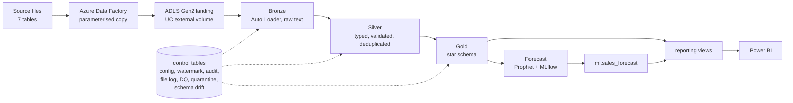

# E-commerce Lakehouse on Azure Databricks

**A reliable data platform and sales forecast for an online retailer: from raw daily files to trusted reporting and a 90-day outlook, delivered as code.**


> The data is synthetic, produced by a generator script, so results show how the platform behaves, not real business performance.

## Contents

1. [Business use case](#business-use-case)
2. [The problem](#the-problem)
3. [The solution](#the-solution)
4. [Business questions it answers](#business-questions-it-answers)
5. [Architecture](#architecture)
6. [How it works](#how-it-works)
7. [Sales forecasting](#sales-forecasting)
8. [CI/CD and environments](#cicd-and-environments)
9. [Skills demonstrated](#skills-demonstrated)
10. [Tech stack](#tech-stack)
11. [Results](#results)
12. [Repository structure](#repository-structure)
13. [Getting started](#getting-started)
14. [Limitations and roadmap](#limitations-and-roadmap)

## Business use case

An online retailer sells through an app, a website, a mobile website and a marketplace. Every day its systems export files: new orders, order lines, payments and reviews, plus a monthly full snapshot of customers, products and sellers. The business wants to answer everyday questions with confidence: *how much did we sell, which products and channels drive revenue and margin, are we delivering on time, and what should we expect next month?*

## The problem

Raw operational files cannot be reported on directly. In this scenario:

| Problem | Business consequence |
|---|---|
| The same file or row is delivered twice | revenue and order counts are inflated |
| Keys are empty, quantities are invalid, status text is inconsistent (`DELIVERED` vs `delivered`) | numbers that don't add up, and no one knows why |
| Customer and product details change over time (address, price) | history is overwritten, so past sales are reported with today's details |
| Events arrive late, or a new column appears mid-stream | pipelines break or silently drop data |
| Nobody can see what ran, what was rejected, or why | no trust in the numbers |
| There is no forward view | planning for inventory, staffing and marketing relies on guesswork |
| Releases are manual | every change risks breaking the reports |

## The solution

A lakehouse on Azure and Databricks that turns those files into trusted, explainable data:

- **Ingest safely.** Every file is loaded exactly once, even if it is delivered again under another name; empty files and schema changes are recorded, not fatal.
- **Validate openly.** Business rules separate good rows from bad. Rejected rows are kept with the reason instead of disappearing.
- **Model for analysis.** A star schema with correct history for customers and products, so every sale is reported with the details that were true at the time.
- **Serve to BI.** Reporting views, with personal data left out, ready for Power BI.
- **Look ahead.** A 90-day sales forecast with calibrated prediction ranges, and a table that lets every past forecast be checked against what really happened.
- **Release safely.** The whole platform is code: reviewed in pull requests, validated automatically, and promoted from dev to prod behind a manual approval.

## Business questions it answers

| Area | Examples |
|---|---|
| Sales | net sales, orders, units and average order value by day, week, month, category, brand and channel |
| Profitability | gross margin and margin percentage using the product cost at the time of the order |
| Customers | new vs returning, city and state, customer history over time |
| Fulfilment | delivery days, late-delivery rate, cancellation rate by channel |
| Payments and satisfaction | payment type mix and instalments, review scores |
| Outlook | expected sales for the next 7, 30 and 90 days, with a realistic range |
| Trust | how many rows were rejected, why, and how accurate past forecasts were |

## Architecture



## How it works

| Layer | Responsibility |
|---|---|
| **Landing** | ADF copies files into ADLS Gen2, keeping the folder structure. A historical load covers past dates; the daily pipeline takes the run date as a parameter. ADF authenticates with its managed identity. Databricks reads the files through a Unity Catalog external volume. |
| **Bronze** | Auto Loader reads only new files and keeps every column as text. Each file is fingerprinted (SHA-256): re-deliveries are skipped, header-only files and new columns are logged. Data is written before the file log, so a crash can cause a repeat, never a lost file. |
| **Silver** | Casts with `try_cast`, applies rules from `control.dq_rules` (severity `quarantine`, `warn` or `fail`), quarantines rejected rows with the raw record, deduplicates by key and `MERGE`s. Customers and products keep every version. Incremental on a watermark over ingest time, moved only after success. |
| **Gold** | A star schema, loaded incrementally for the orders that changed. |
| **Reporting** | Views for BI: star-schema views, daily and monthly aggregates, the forecast and its accuracy. Customer name, email and phone are not exposed. |

### Gold data model

| Table | Grain |
|---|---|
| `dim_date` | calendar day (2024-2028) |
| `dim_seller` | seller (latest state) |
| `dim_product` | product **version** (SCD Type 2) |
| `dim_customer` | customer **version** (SCD Type 2) |
| `fact_order_items` | order line: revenue, discount, freight |
| `fact_orders` | order: status, delivery times, totals, late flag |
| `fact_payments` | payment |
| `fact_reviews` | review |

An **Unknown member** (key `-1`) on every dimension keeps facts that arrive before their dimension row, and they are re-linked on later runs. Money is `DECIMAL`, never floating point. Surrogate keys are deterministic (`xxhash64`).

### Control framework

Everything the platform needs to run and explain itself is a table in the `control` schema:

| Table | Purpose |
|---|---|
| `pipeline_config` | one row per source table: keys, load type, SCD type, active flag. A new table is a config row. |
| `watermark` | last processed position per table and layer |
| `pipeline_run_audit` | one row per table per run: status, row counts, duration, Delta version, error |
| `file_ingestion_log` | one row per file with content hash and status |
| `dq_rules`, `dq_results` | validation rules and their outcome per run |
| `quarantine_records` | rejected rows with the rule that rejected them |
| `schema_drift_log` | columns added at ingestion |

## Sales forecasting

**Goal:** forecast total daily net sales 90 days ahead (also as 7-day and 30-day blocks) for inventory, staffing and marketing planning.

1. **Explore:** two years of history, strong yearly seasonality (October peak), a mild weekly pattern, slowing growth.
2. **Baselines:** a 28-day average, the weekday average of the last four weeks, and "same day last year × recent growth".
3. **Model:** Prophet with multiplicative seasonality and a business event calendar (`ml.event_calendar`: sales events and holidays).
4. **Backtest:** from a start date every 14 days since Dec 2025, predict 7, 30 and 90 days using only earlier history, and compare with what happened.

| Horizon | Best baseline (daily error) | Prophet + events (daily error) | Prophet + events (window-total error) |
|---|---|---|---|
| 7 days | 21.0% | 16.4% | 7.7% |
| 30 days | 22.8% | 17.5% | 6.9% |
| 90 days | 23.2% | 17.6% | 5.7% |

*Error is WAPE: total absolute error divided by total actual. Single days are noisy; weekly and monthly totals are far more predictable, and those are what planning uses.*

**Honest ranges.** Prophet's own 80% range contained the real value only 65-68% of the time. Ranges are calibrated from backtest errors (separately for days, 7-day and 30-day blocks), stored in `ml.forecast_calibration`; on windows the calibration had not seen, the 80% range held 87-90% of the time.

**Model management.** Each training run is logged to MLflow and registered in Unity Catalog as `<catalog>.ml.sales_forecast_prophet`; scoring loads the version holding the `champion` alias. `ml.sales_forecast` is append-only, so `reporting.forecast_accuracy` can compare every past forecast with actual sales as days pass.

## CI/CD and environments

- **CI** (`.github/workflows/ci.yml`), on every pull request: `ruff` lint, unit tests, `databricks bundle validate`.
- **CD** (`.github/workflows/cd.yml`), after a merge to `main`: deploy to **dev**, then to **prod** after a **manual approval**.
- A Databricks **service principal** (OAuth) deploys; its credentials exist only as GitHub secrets.
- `ecom-pipeline/` is a **Databricks Asset Bundle**: one job (bronze, silver, gold, forecast scoring) with a `catalog` variable per environment.

| Environment | Catalog | State |
|---|---|---|
| dev | `ecom_dev` | loaded with data |
| prod | `ecom_prod` | job deployed behind an approval gate; **not loaded with data** |

## Skills demonstrated

| Area | What this project shows |
|---|---|
| **Data engineering** | medallion architecture, incremental and idempotent loads, watermarks, `MERGE`, late-arriving data, schema drift handling |
| **Data modelling** | dimensional modelling, SCD Type 2, unknown members, deterministic surrogate keys |
| **Data quality and observability** | rule engine with severities, quarantine, run audit, file log |
| **Azure** | ADLS Gen2, Data Factory (parameterised pipelines, managed identity), Azure Databricks |
| **Databricks** | Unity Catalog (volumes, external locations, registry), Auto Loader, serverless compute, Workflows |
| **Data science and MLOps** | time-series forecasting, rolling backtests, baselines, calibrated intervals, MLflow tracking and model registry |
| **DevOps** | Asset Bundles, GitHub Actions CI/CD, environments with approval, service principal authentication, secrets handling |
| **Engineering practice** | metadata-driven design, unit tests, lint, pull-request workflow, honest documentation of limits |

## Tech stack

| Area | Technology |
|---|---|
| Storage and ingestion | ADLS Gen2, Azure Data Factory |
| Processing | Azure Databricks (serverless), PySpark, Delta Lake, Auto Loader |
| Governance | Unity Catalog, access connector, external locations |
| ML | Prophet, MLflow, Unity Catalog model registry |
| Delivery | Databricks Asset Bundles, GitHub Actions |
| BI | Power BI (reporting views ready; dashboards not yet built) |

## Results

Verified in dev:

| Check | Result |
|---|---|
| Silver orders (= distinct orders in Bronze) | 59,468 |
| Order rows quarantined by rules | 724 |
| `gold.fact_orders` / `fact_order_items` | 59,468 / 98,978 rows |
| `gold.fact_payments` / `fact_reviews` | 65,324 / 35,281 rows |
| `gold.dim_customer` / `dim_product` | 48,660 / 4,455 versions |
| History covered | 2024-11-01 to 2026-10-31 (730 days) |

## Repository structure

```
src/ecom/             Python package: bronze, silver, silver_specs, gold, forecast, forecast_train, audit, control, config
src/notebooks/        notebook entry points (bronze, silver, gold, forecasting)
ecom-pipeline/        Databricks Asset Bundle (databricks.yml, resources/)
adf/                  Azure Data Factory resources
tests/                unit tests
.github/workflows/    CI and CD
```

## Getting started

**Prerequisites:** an Azure subscription; an ADLS Gen2 account (hierarchical namespace) with a landing container; an Azure Databricks Premium workspace with Unity Catalog; an access connector with a storage credential and external location; an ADF instance whose managed identity can write to the storage account.

1. Create the catalog, schemas (`bronze`, `silver`, `gold`, `reporting`, `control`, `ml`) and the `landing` and `checkpoints` volumes.
2. Import the ADF resources from `adf/` and run the historical load to land the files.
3. Seed `control.pipeline_config` with the seven source tables.
4. Deploy the bundle: `cd ecom-pipeline && databricks bundle deploy -t dev`, or use the Deployments panel in the workspace.
5. Run the `ecom - daily pipeline` job.

*Silver, Gold and `ml` table definitions are not yet scripted (see Roadmap), so step 1 needs them created from the documented schemas.*

## Limitations and roadmap

**Limitations**
- Two years of history: each season has been seen twice, so the November-January forecast is lower confidence, and no backtest could start right after a festive peak.
- The festive event is modelled with a separate effect per year because its length changed (11 and 22 days); a future edition needs an intensity input from marketing. Events after October 2026 in the calendar are assumptions.
- Forecasts have not yet been compared with real post-October actuals.
- Prod is empty by design; it demonstrates the release path, not a data load.
- No automated tests of the Spark logic yet; unit tests cover specifications and rule consistency.
- Customer personal data is excluded from reporting but not masked in Gold.

**Roadmap**
- Power BI dashboards on the reporting views (sales, delivery, forecast with ranges).
- A setup job in the bundle that creates every table definition.
- Column masking for customer personal data in Unity Catalog.
- Load prod and add a test environment.
- Scheduled retraining with a promotion check based on `forecast_accuracy`.

## Author

**Dorigundla vishnuvardhan reddy** · <[LinkedIn or portfolio link](https://www.linkedin.com/in/vishnu-vardhan-reddy-dorigundla-353bb1255/)>


## outputs:


#### adf


### acess connector


### databricks


